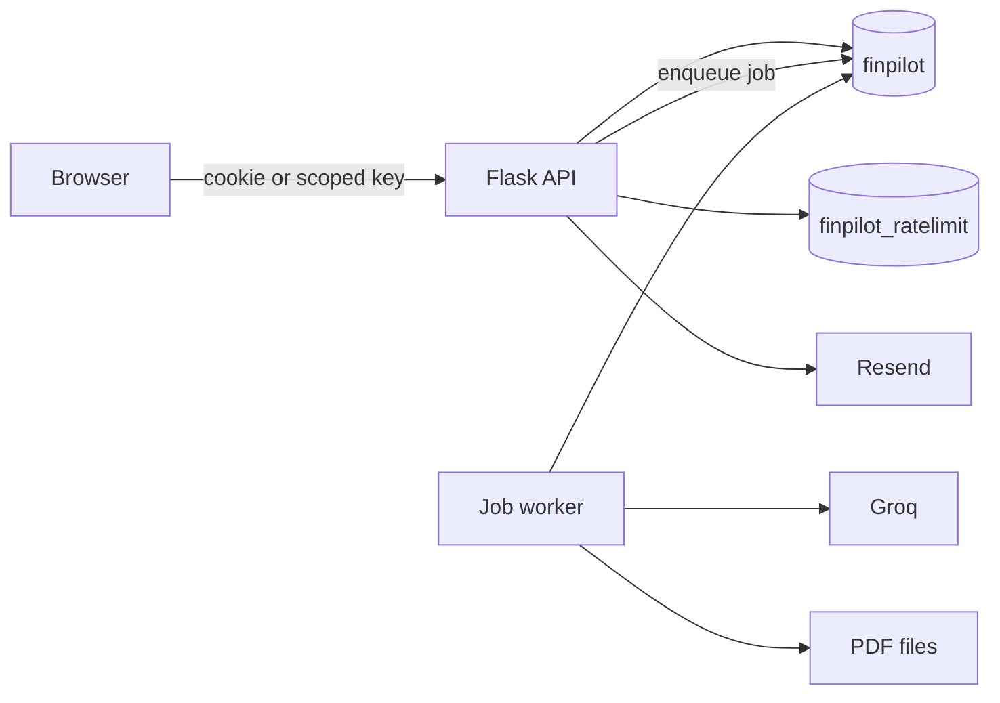
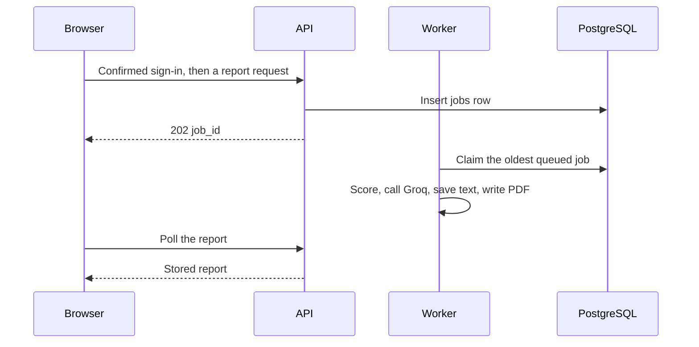

# Platform

## Explanation

Monetra is a signed-in web app. The browser is a React app on the public site. The API is Flask. A second process claims report and chat jobs and calls Groq. PostgreSQL holds the accounts and the rate-limit counters in two databases. PDF files are on disk. Mail goes out through Resend.

The API does not call Groq inside the HTTP request. The browser does not hold an API key.

## High-level design

## Low-level design

| Piece | Where it lives |
|---|---|
| Process switch | `FINPILOT_PROCESS` is `api` or `worker` in the image |
| API factory | `app.py` |
| Browser | `frontend/`, Vite, no router package |
| Public site | `https://monetra.site` |
| API host | Railway service `finpilot-api` |
| Worker host | Railway service `finpilot-worker` |

Local development runs `python app.py` and `python -m services.jobs.worker` beside Vite. Production runs Gunicorn for the API and the worker command for jobs. `python app.py` exits before it listens when `FLASK_ENV` is outside `development`, `dev`, and `local`.

## Sequence

