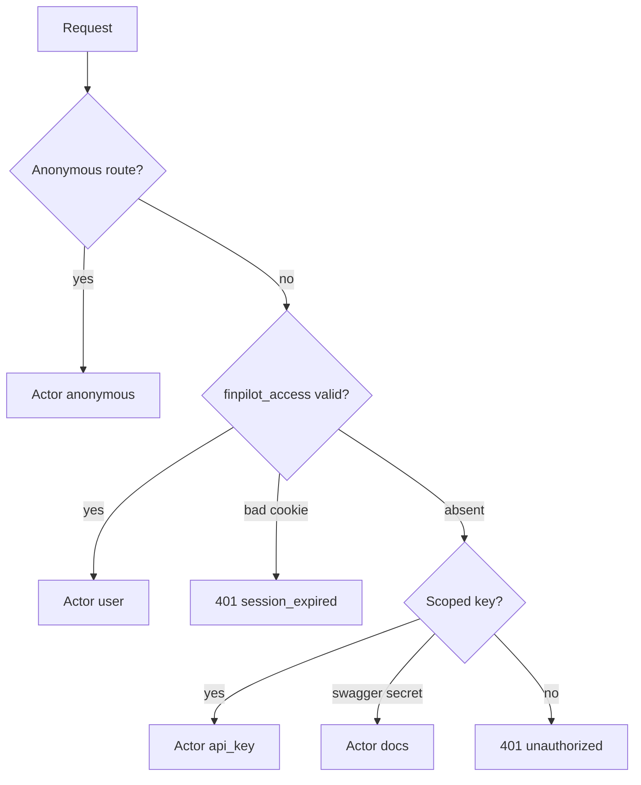
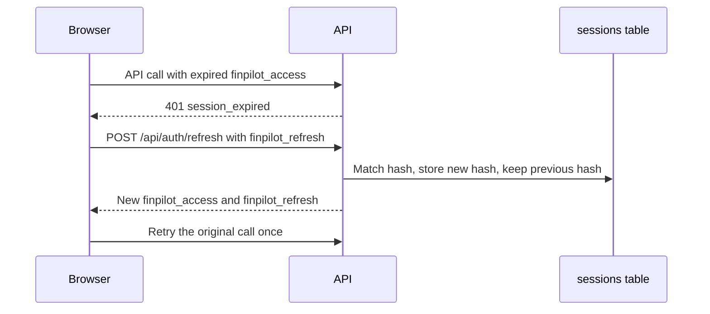

# Identity and sessions

## Explanation

Every application request becomes one `Actor` before a quota is counted. A browser proves itself with `finpilot_access`. A script proves itself with a scoped key. Those two callers see the same account. Neither is a superuser.

The access cookie lasts 15 minutes. The refresh cookie lasts 7 days from the session row and does not slide. Logout revokes only that session.

## High-level design

## Low-level design

| Rule | Detail |
|---|---|
| Access cookie | Signed with `SESSION_SECRET`, salt `finpilot-access`. Payload is `account_id`, `session_id`, `session_version`. Path `/`. |
| Refresh cookie | Opaque secret. SHA-256 stored on `sessions`. Path `/api/auth/refresh`. |
| Live session | `revoked_at` is null, `expires_at` is in the future, and `session_version` matches the account. |
| Bad access cookie | Does not fall through to `X-API-Key`. |
| Refresh | Rotates the secret, keeps `previous_secret_hash`, does not extend `expires_at`. Reuse of the previous secret revokes that session only. |
| Cookie flags | Local Flask: `SameSite=Lax`, `Secure` false. Otherwise `SameSite=None` and `Secure`. |
| Legacy name | `finpilot_session` is cleared and is not issued. |
| Scoped key | `api_credentials.key_sha256`. Scopes `data` and `llm`. `API_SECRET_KEY` is Swagger only. |

Files: `services/actor.py`, `services/sessions.py`, `database/repository.py`.

## Sequence

