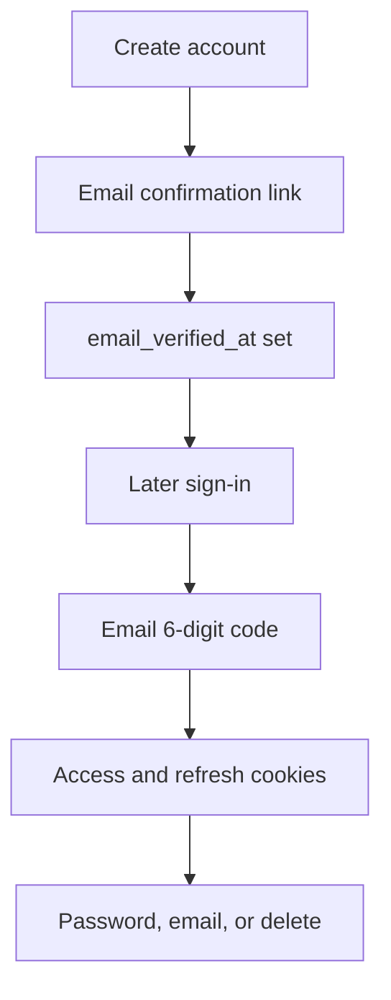
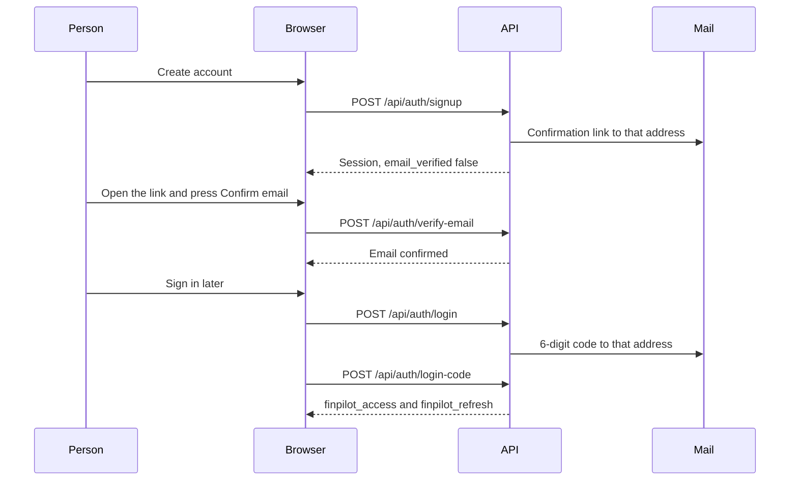

# Account lifecycle

## Explanation

A new account confirms its email once, with a link. Every later sign-in uses a 6-digit code. Password reset, email change, and deletion are separate proofs. The signup link is not asked for again after `email_verified_at` is set.

## High-level design

## Low-level design

| Step | Route | Result |
|---|---|---|
| Signup | `POST /api/auth/signup` | Account row, verification challenge, both cookies. Address is not confirmed. |
| Confirm link | `POST /api/auth/verify-email` | Sets `email_verified_at`. Opening the page does not consume the secret. |
| Unconfirmed sign-in | `POST /api/auth/login` | Does not set a session. Sends the signup link again. `403` `email_unverified`. |
| Confirmed sign-in | `POST /api/auth/login` | Password check, then a 10-minute `login_code`. No cookies yet. |
| Code | `POST /api/auth/login-code` | Sets both cookies. Five wrong codes consume the challenge. |
| Logout | `POST /api/auth/logout` | Revokes that session only. |
| Forgot / reset | `POST /api/auth/forgot-password`, `POST /api/auth/reset-password` | Same 200 sentence for every address. Reset revokes every session and bumps `session_version`. |
| Change email | `POST /api/auth/change-email`, `POST /api/auth/confirm-email` | The account email changes only on confirm. Both sessions end. |
| Change password | `POST /api/auth/change-password` | Current password, 12-character rule, every session revoked, cookies cleared. |
| Delete | `POST /api/auth/delete-account` | Current password and the email typed again. One transaction, then PDF files. Body is `Account deleted.` |

Challenges live in `auth_challenges`. Purposes are `verify_email`, `reset_password`, `change_email`, and `login_code`. Links last 30 minutes. The code lasts 10 minutes.

Files: `routes/auth_routes.py`, `services/verification.py`, `services/login_code.py`, `services/password_reset.py`, `services/email_change.py`.

## Sequence

