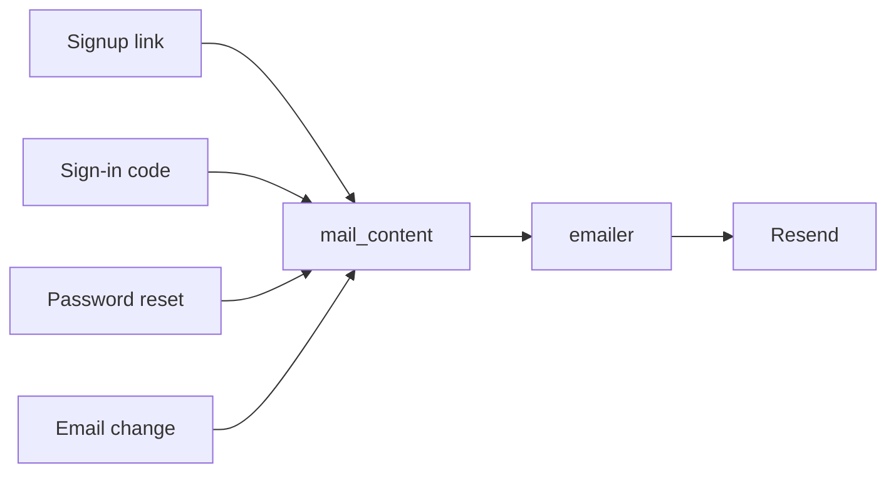
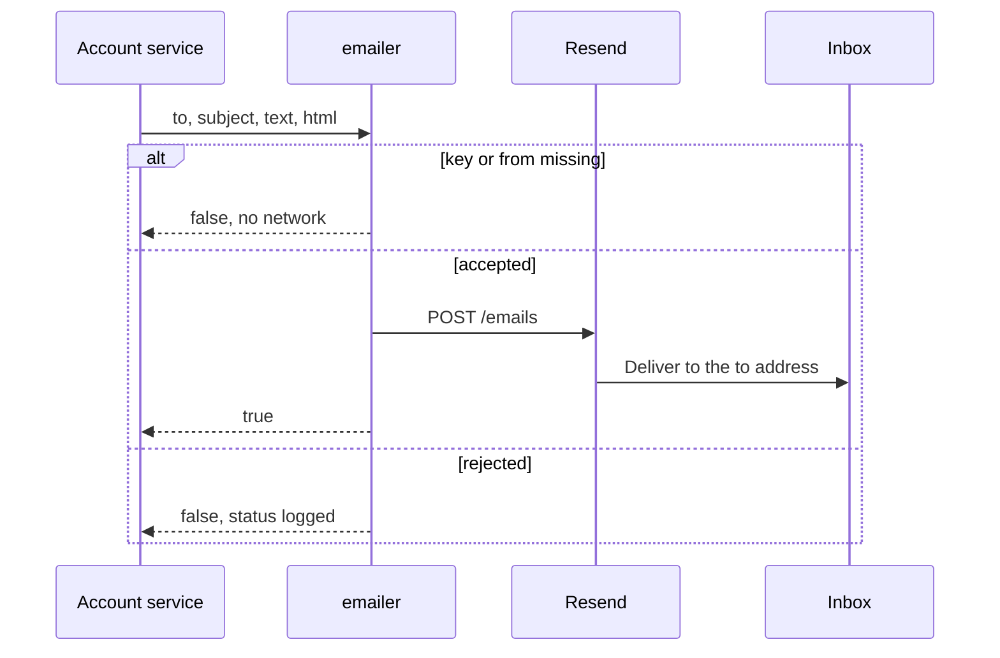

# Email

## Explanation

One function sends mail. It posts to Resend. The recipient is the address the caller passes, which for account mail is the normalized address on the form. The message has a plain-text body and an HTML body. Both name that recipient.

A missing `EMAIL_API_KEY` or `EMAIL_FROM` logs and skips the network so the API can still start. Tests blank those values before config is imported.

## High-level design

## Low-level design

| Piece | Detail |
|---|---|
| `services/emailer.py` | `POST https://api.resend.com/emails`. `to` is a one-element list. User-Agent `Monetra`. A rejection logs the status and a short response body. |
| `services/mail_content.py` | Title, recipient line, paragraphs, optional code, optional button, expiry, ignore sentence, footer. |
| `EMAIL_FROM` | Display name and address. Production is `Monetra <noreply@monetra.site>`. `onboarding@resend.dev` delivers only to the Resend account inbox. |
| `APP_PUBLIC_URL` | Origin used in links. No path and no trailing slash. Production is `https://monetra.site`. |
| Subjects | Confirm your Monetra email. Your Monetra sign-in code. Reset your Monetra password. Confirm your new Monetra email. Monetra email change requested. |

The signup link, reset link, and email-change link are `{APP_PUBLIC_URL}` plus `/verify-email`, `/reset-password`, or `/confirm-email`, with `id` and `token`. The sign-in message carries the 6-digit code and no link.

## Sequence

