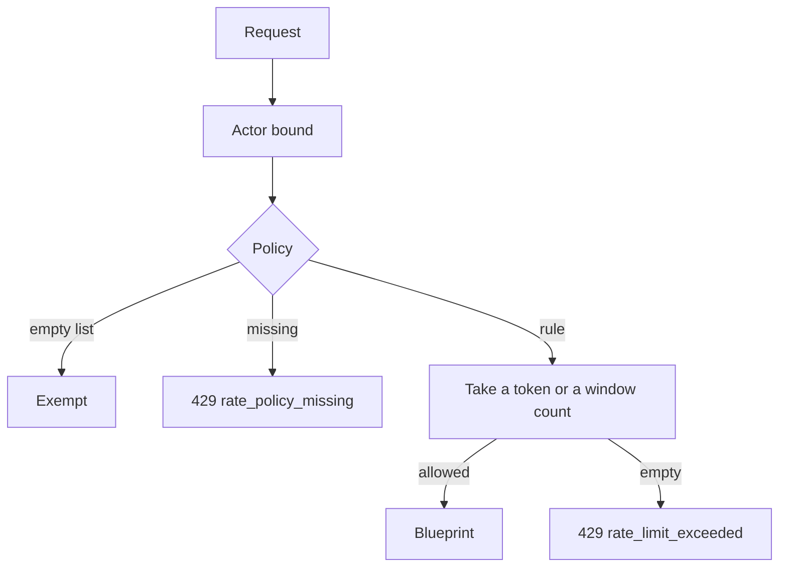
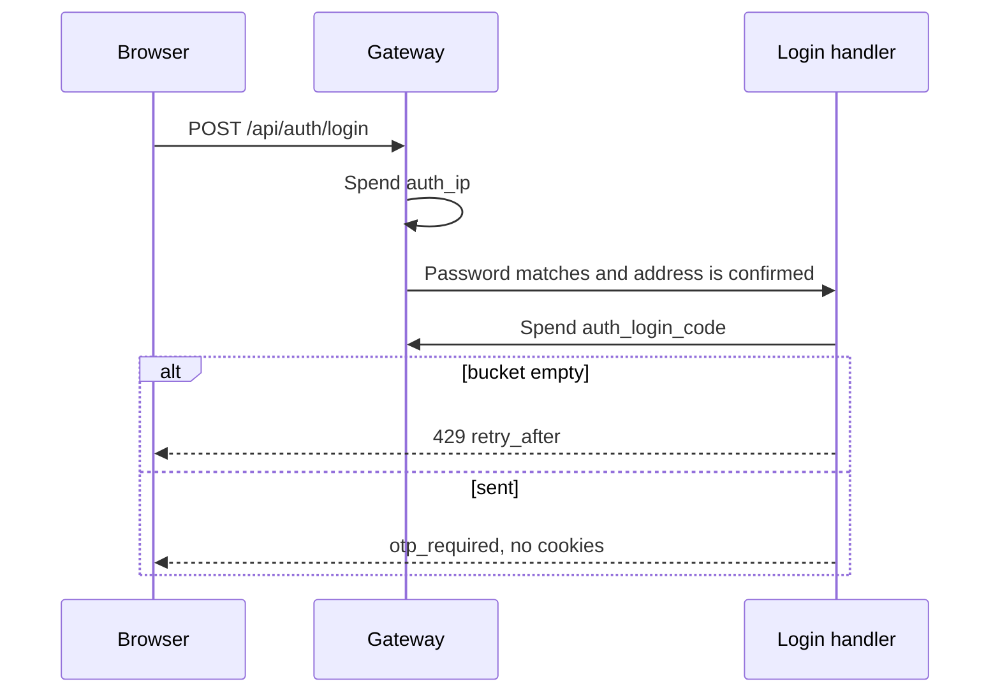

# Rate limiting

## Explanation

The gateway in `services/rate_limit` is the live counter when the backend is `sql` or `memory`. Flask-Limiter stays imported and is not the live counter. An application route with no policy returns `429` `rate_policy_missing`. Health is exempt. A store error on an auth class fails closed.

Auth buckets start full. A token is spent when the request is counted. Refill adds one token on the stated interval.

## High-level design

## Low-level design

Auth token buckets:

| Class | Capacity | Refill | Key |
|---|---|---|---|
| `auth_ip` | 8 | 1 per 15 seconds | client address |
| `auth_account` | 5 | 1 per 10 minutes | email hash. Wrong passwords only. |
| `auth_refresh` | 4 | 1 per 60 seconds | session id |
| `auth_resend` | 3 | 1 per 10 minutes | email hash |
| `auth_login_code` | 5 | 1 per 60 seconds | email hash |
| `auth_account_action` | 5 | 1 per 60 seconds | account id |
| `auth_challenge` | 5 | none | challenge id |

`credential_failure` stays a fixed window, 20 per minute, for rejected API keys. Report, chat, goal, and read quotas are unchanged and live in config. They are not listed here so this file does not become a second source that drifts.

`POST /api/auth/login-code` is exempt from `auth_ip`. Wrong codes spend `auth_challenge`. Sending the code spends `auth_login_code`.

Files: `services/rate_limit/policies.py`, `services/rate_limit/gateway.py`.

## Sequence

