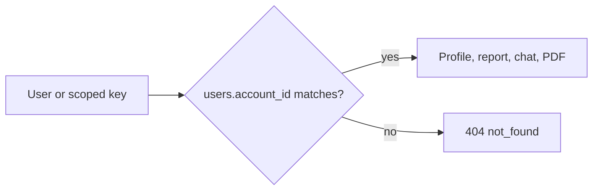
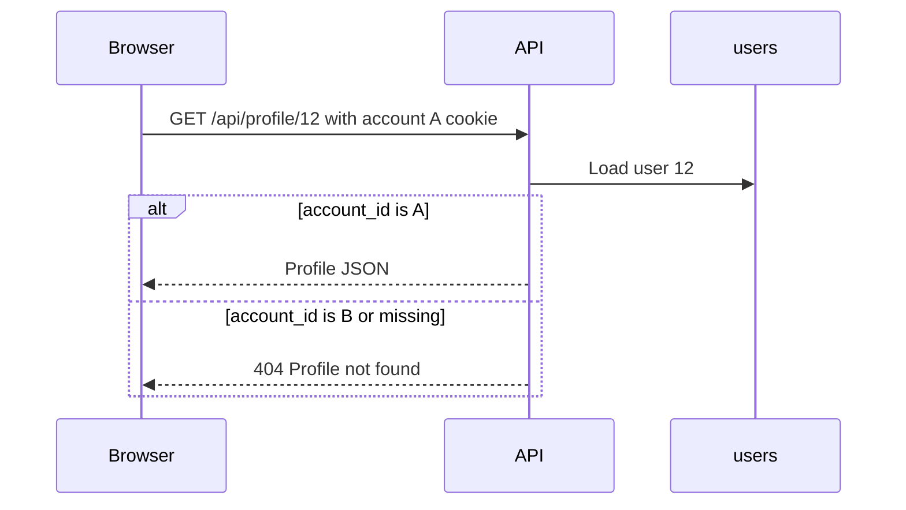

# Profiles

## Explanation

A profile is a row in `users`. It belongs to one account. The browser and a scoped key for that account see those rows. Another account receives `404` `not_found`. There is no profile-edit route. Creating a profile requires a confirmed email.

## High-level design

## Low-level design

| Route | Rule |
|---|---|
| `GET /api/users` | Profiles for the caller. Policy `read_light`. |
| `POST /api/profile` | Create. Confirmed email. Policy `write_profile`. |
| `GET /api/profile/<id>` | Owned row or `404`. Confirmed email. Policy `read_light`. |
| `DELETE /api/profile/<id>` | Owned row. Cascades report, chat, and jobs on that profile. |

`get_user_by_id` is the ownership check. A mismatch is hidden as not found. Goal results are not stored on the server.

Files: `routes/user_routes.py`, `database/repository.py`.

## Sequence

