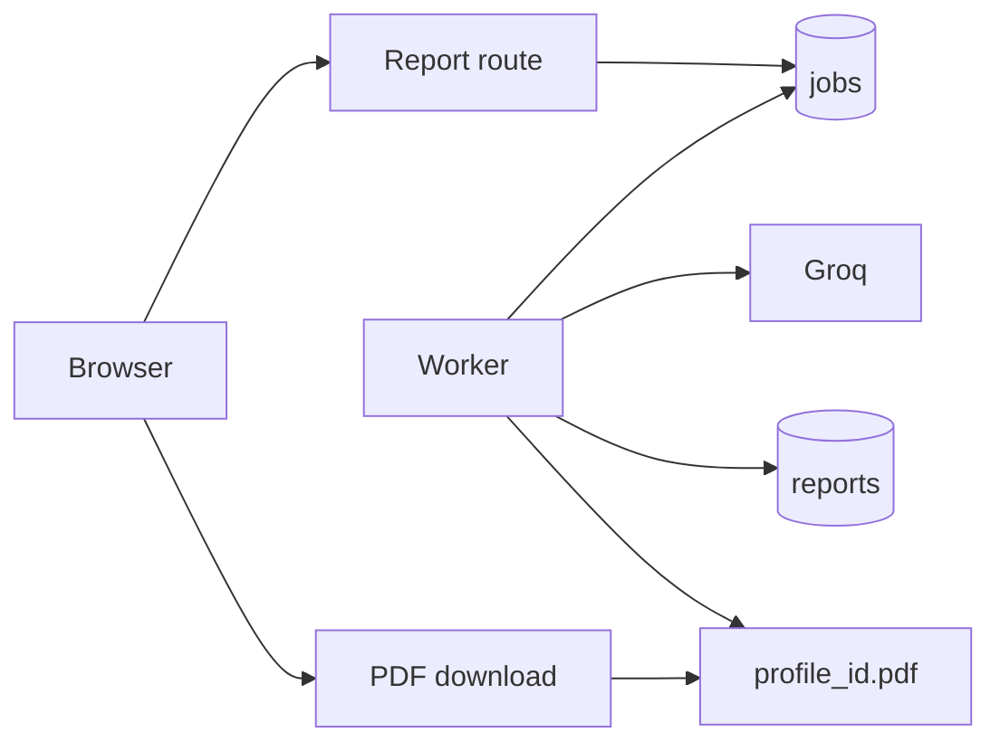
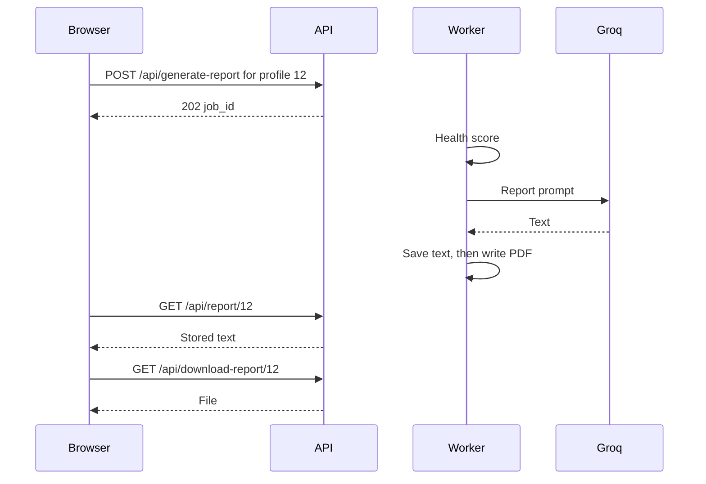

# Reports and PDF

## Explanation

A report request inserts a job and returns `202`. The worker scores the profile, calls Groq, saves the text, then writes `profile_<id>.pdf`. The browser polls until the text is stored. The PDF is a separate download.

The HTTP request does not call Groq. A PDF failure still leaves the job succeeded because the text was already saved.

## High-level design

## Low-level design

| Rule | Detail |
|---|---|
| Enqueue | `POST /api/generate-report` with `user_id`. Owner and confirmed email. One active report job per profile. |
| Status | `GET /api/report/<user_id>` returns the stored report. A queued, running, or failed job is included as `job`. No report and no job is `404`. |
| PDF | `GET /api/download-report/<user_id>`. Owner only. Missing file is `404`. |
| File name | `profile_<user_id>.pdf` under `Config.PDF_STORAGE_DIR`. The row stores the name, not the bytes. |
| Cover | `Prepared by Monetra`. |
| Score | Seven-pillar health score in `services/health_service.py`. It does not call Groq. |

Files: `routes/report_routes.py`, `services/jobs/worker.py`, `services/ai_service.py`, `services/pdf_service.py`, `database/pdf_files.py`.

## Sequence

