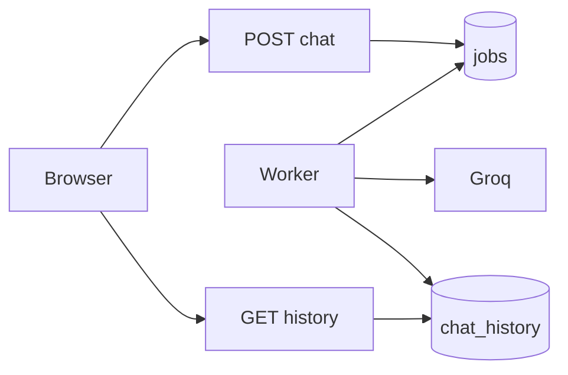
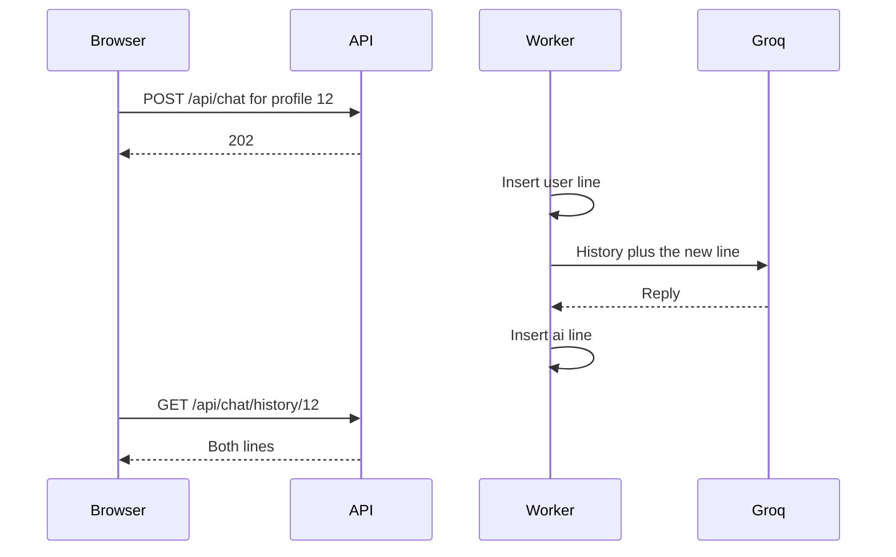

# Chat

## Explanation

A chat turn inserts a job and returns `202`. The worker writes the user line, calls Groq, and writes the assistant line. The browser polls history. Clearing history does not cancel a job that is already running.

The model system prompt identifies the assistant as Monetra and keeps the educational disclaimer.

## High-level design

## Low-level design

| Route | Rule |
|---|---|
| `POST /api/chat` | Body names the profile. Owner, confirmed email, non-empty message. `202` and `job_id`. |
| `GET /api/chat/history/<user_id>` | History for that profile. |
| `DELETE /api/chat/history/<user_id>` | Deletes the history rows. |

`chat_history.role` is `user` or `ai`. Rows cascade when the profile is deleted. The header `X-FinPilot-Stub-Delay-Ms` is a test stub only.

Files: `routes/chat_routes.py`, `services/jobs/worker.py`, `services/ai_service.py`.

## Sequence

