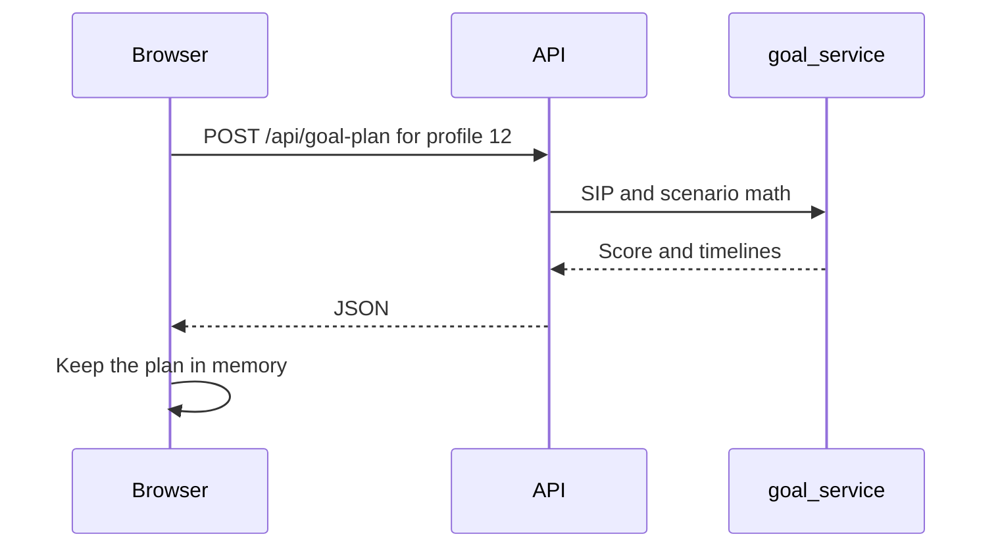

# Goals

## Explanation

Goal math runs inside the request. It does not call Groq and it does not write a job. The SIP payment, the three scenarios, the feasibility score, and the timeline search are deterministic.

Saved goals stay in the browser. The server does not keep a goal list.

## High-level design

## Low-level design

| Piece | Detail |
|---|---|
| Route | `POST /api/goal-plan`. The body names the profile. Owner and confirmed email. |
| Inputs | Goal amount, years, monthly savings, risk appetite. |
| Instruments | Static CAGR tiers for Low, Medium, and High. |
| Output | Conservative, Balanced, and Aggressive projections, a 0–100 score, and an achievable timeline. |
| Persistence | None on the server. |

Files: `routes/goal_routes.py`, `services/goal_service.py`.

## Sequence

