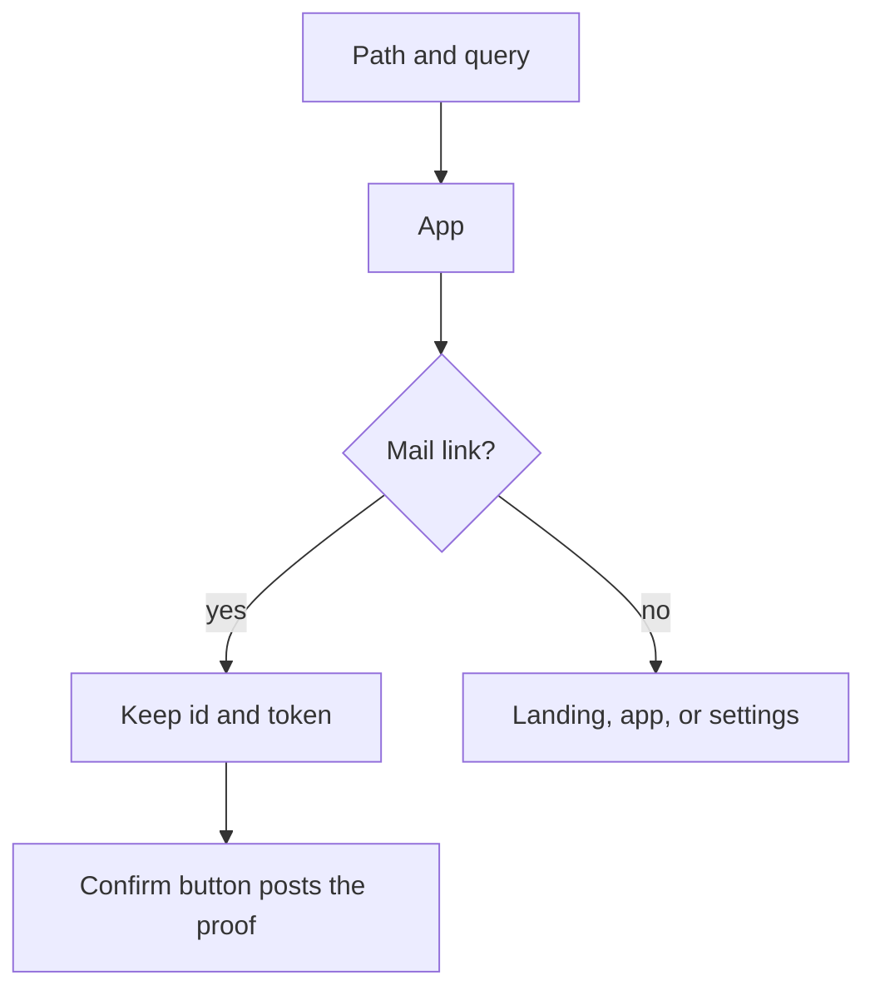
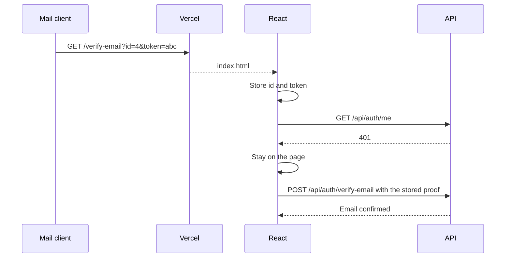

# Frontend

## Explanation

The React app is one page. Paths are read from `window.location`. There is no router package. Vercel rewrites unknown paths to `index.html`, so a mail link loads the app instead of a platform 404.

The confirmation, reset, and email-change pages capture `id` and `token` on the first render. A later navigation that stays on the same path keeps the query. A missing session on those paths does not send the person to the landing page.

## High-level design

## Low-level design

| Piece | Detail |
|---|---|
| Paths | `/`, `/profile`, `/dashboard`, `/advisory`, `/chat`, `/goals`, `/settings`, `/verify-email`, `/reset-password`, `/confirm-email` |
| API | `VITE_API_URL` or `/api`. `credentials: include`. |
| Refresh | One retry through `POST /api/auth/refresh` after `session_expired`. |
| Mail proof | `useState` initializer reads the query before effects. Pages submit `proof.id` and `proof.token`. |
| Same-path navigation | `locationForSamePath` keeps `search` and `hash`. Leaving the path drops them. |
| Session-expired event | `finpilot:session-expired`. On a mail link, the handler clears account state and does not call `go("/")`. |
| Product copy | The visible name is Monetra. |

Files: `frontend/src/App.jsx`, `frontend/src/lib/routes.js`, `frontend/vercel.json`, `frontend/src/pages/VerifyEmail.jsx`.

## Sequence

