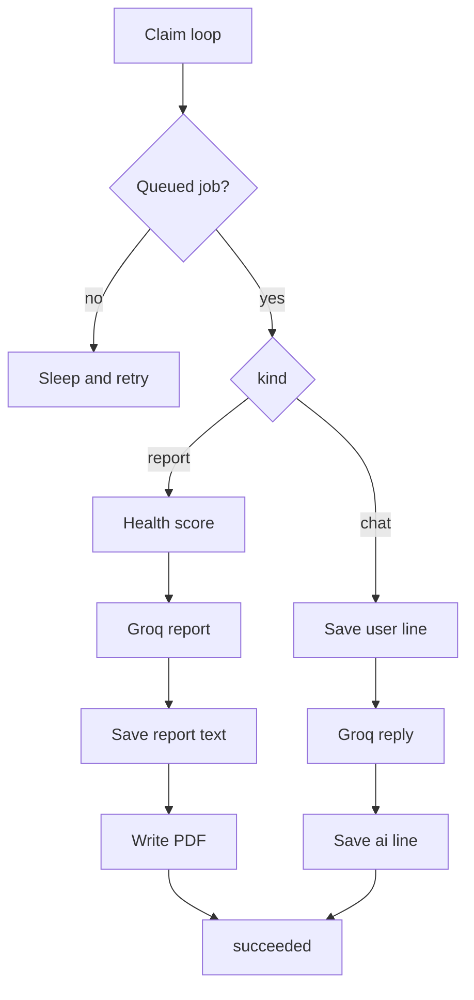
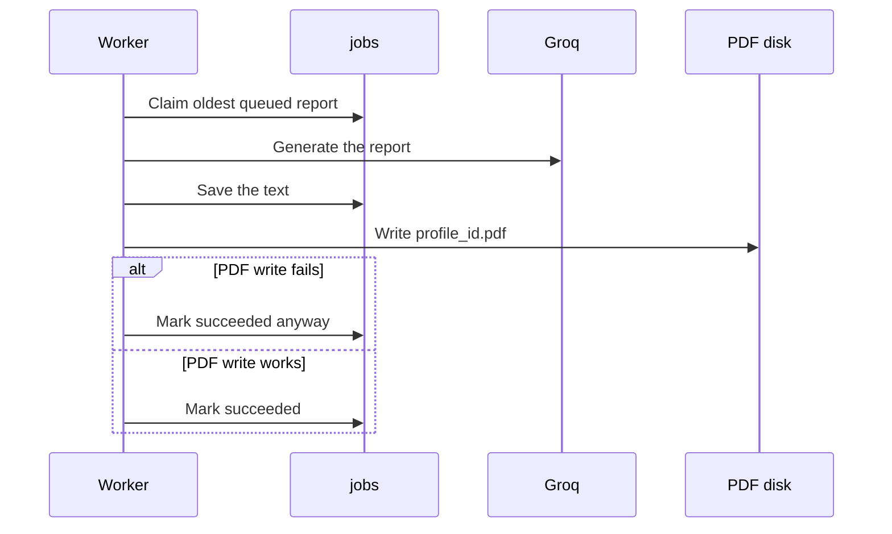

# Jobs worker

## Explanation

The worker is a separate process. It claims the oldest queued report or chat job, runs it, and marks it succeeded or failed. Report text is saved before the PDF is written. The default claim width is one thread.

The worker does not send mail and does not hold the Resend key.

## High-level design

## Low-level design

| Rule | Detail |
|---|---|
| Command | `python -m services.jobs.worker` |
| Claim | `FOR UPDATE SKIP LOCKED` on the oldest queued row |
| Threads | `WORKER_CLAIM_THREADS`. Default 1. `0` means one thread. |
| Kinds | `report` and `chat` only. The database check rejects anything else. |
| Report order | Score, model, save text, then PDF. A PDF error does not fail the job. |
| Chat order | User line, model, assistant line. |
| Poison | A job that crashes is marked failed and is not claimed again. |

Files: `services/jobs/worker.py`, `services/jobs/`.

## Sequence

