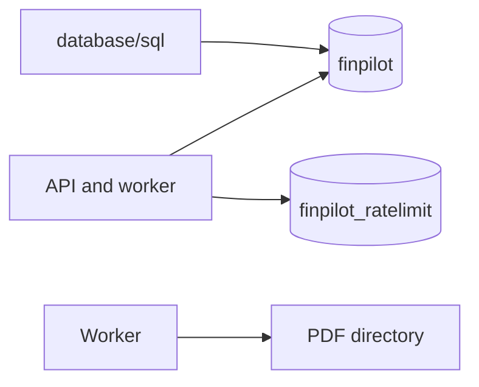
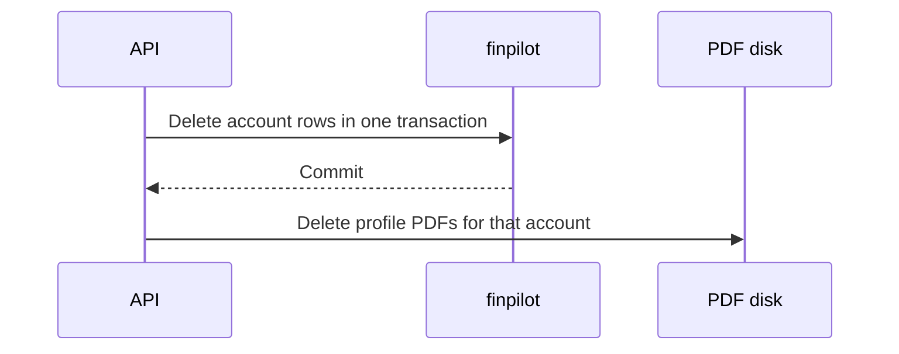

# Data stores

## Explanation

Application rows live in PostgreSQL database `finpilot`. Rate-limit counters live in `finpilot_ratelimit`. PDF bytes live on disk. There is no migration tool. Schema changes are idempotent SQL applied at startup.

Deleting an account removes its rows and its PDF files. Operator backups are outside that deletion. This document does not state a retention period.

## High-level design

## Low-level design

| Store | Contents |
|---|---|
| `accounts` | Email, password hash, `auth_provider`, `session_version`, `email_verified_at` |
| `sessions` | Refresh hash, previous hash, expiry, revocation |
| `auth_challenges` | Signup link, sign-in code, password reset, email change |
| `users` | Profiles. `account_id` references `accounts`. |
| `reports` | Advisory text and the PDF file name. One row per profile. |
| `chat_history` | `role` is `user` or `ai`. |
| `jobs` | `kind` is `report` or `chat`. |
| `api_credentials` | SHA-256 of a scoped key. `revoked_at` retires it. |
| `finpilot_ratelimit` | Token buckets and fixed windows |
| Disk | `profile_<user_id>.pdf` |

`SQLITE_IMPORT` is off by default. The pool is the application pool already configured. Schema files are under `database/sql/` and are applied by `database/db.py`.

## Sequence

