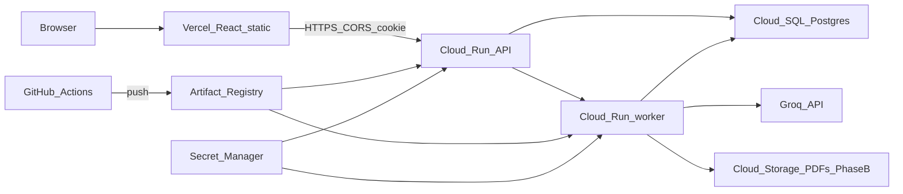

# FinPilot — GCP deployment on free credits

**Status:** plan only. Complements the primary free-tier path in `docs/deployment/DEPLOYMENT_STRATEGY.md`.  
**Audience:** someone with a new GCP account that includes approximately **$200 in free credits** (eligibility and amount are Google’s; verify in the console).  
**Frontend:** stays on **Vercel** (still free). This document covers the Google Cloud backend and data plane.  
**As-built app:** `docs/architecture/ARCHITECTURE.md`.

Do not treat this as a commitment that $200 lasts a fixed number of months. Always-on Cloud SQL and Cloud Run with min instances > 0 consume credits continuously. Use budgets and alerts from day one.

---

## 1. Why a separate GCP path

Railway’s trial (~$5) is enough for a short demo. GCP free credits give a longer runway for:

- Managed PostgreSQL (Cloud SQL)
- Two Cloud Run services (API + worker) from one container image
- Secret Manager for keys
- Optional durable PDF storage on Cloud Storage (Phase B)

The process model does not change: HTTP never calls Groq; `python -m services.jobs.worker` claims jobs from Postgres.

---

## 2. Target architecture



### Services to use

| Need | GCP service | Notes |
|---|---|---|
| Project + billing | GCP project with billing linked to free credits | Enable budget alerts immediately |
| Container registry | **Artifact Registry** (Docker) | Prefer this on GCP; Docker Hub remains an alternate source |
| API | **Cloud Run** service `finpilot-api` | Gunicorn; public HTTPS |
| Worker | **Cloud Run** service `finpilot-worker` | Same image; different command; no public ingress required |
| Databases | **Cloud SQL for PostgreSQL 16** | One instance; databases `finpilot` and `finpilot_ratelimit` |
| Secrets | **Secret Manager** | `GROQ_API_KEY`, `SESSION_SECRET`, `API_SECRET_KEY`, DB URLs |
| PDF files (Phase B) | **Cloud Storage** bucket | Requires a code change from local disk I/O |
| CI/CD | **GitHub Actions** + Workload Identity Federation, or **Cloud Build** | Build → push → deploy Cloud Run |
| Logs | **Cloud Logging** | Default for Cloud Run / SQL |
| Frontend | **Vercel** (not GCP) | `VITE_API_URL` → Cloud Run API URL |

Intentionally unused for this plan: GKE, Compute Engine VMs as the primary runtime, Memorystore Redis, Cloud CDN for the API, Firebase Auth (app keeps its own email/password cookie).

---

## 3. Pre-deploy gaps (same as Railway path)

Before any public Vercel → Cloud Run login works:

1. Production session cookies are already `SameSite=None; Secure` when `FLASK_ENV` is outside local development ([`services/sessions.py`](../../services/sessions.py)). Keep `FLASK_ENV=production`.
2. `CORS_ORIGINS` must list the exact Vercel origin(s).
3. `FLASK_ENV=production` and non-default database passwords.
4. Multi-stage image exists and is pushed (see primary strategy §4, or push the same Dockerfile to Artifact Registry).
5. `VITE_API_URL` is the absolute Cloud Run API `/api` prefix at Vercel build time.

See `docs/deployment/DEPLOYMENT_STRATEGY.md` §3 for detail.

---

## 4. PDF storage: Phase A vs Phase B

Current code ([`database/pdf_files.py`](../../database/pdf_files.py)) reads and writes files under `PDF_STORAGE_DIR` on local disk. Cloud Run’s container filesystem is **ephemeral**.

| Phase | Approach | Durable downloads? | Code change? |
|---|---|---|---|
| **A — demo only** | Write PDFs under `/tmp` (or container disk); rely on report text in Postgres; accept that PDF files vanish on new revisions / cold instances | No | Minimal (`PDF_STORAGE_DIR=/tmp/pdfs`) |
| **B — durable GCP** | Store PDF bytes (or objects) in a **Cloud Storage** bucket; API download streams from GCS; worker uploads after ReportLab | Yes | Required |

**Phase B is required** for a GCP deploy you would show to real users who expect PDF download after redeploy. Phase A is only for proving health, auth, enqueue, and advisory text.

Phase B implementation sketch (later wave, not this doc’s deliverable):

- Bucket e.g. `gs://PROJECT-finpilot-pdfs` (uniform bucket-level access, private)
- Worker: after building PDF bytes, `upload` to `profile_<user_id>.pdf`
- API download route: ownership check (already required) then stream from GCS instead of `load_pdf_bytes` from disk
- IAM: Cloud Run runtime service accounts with `roles/storage.objectAdmin` on that bucket only

---

## 5. Setup guide

Order matters. Complete each chapter before the next.

### 5.1 Project, billing, and budgets

1. Create or select a GCP project.
2. Link a billing account that carries the free credits.
3. Create a **budget** (e.g. alert at 50%, 90%, 100% of a soft cap you choose under $200).
4. Note the project ID: `PROJECT_ID`.
5. Choose a region and stick to it (e.g. `asia-south1` or `us-central1`): `REGION`.

### 5.2 Enable APIs

Enable at least:

- `run.googleapis.com`
- `sqladmin.googleapis.com`
- `artifactregistry.googleapis.com`
- `secretmanager.googleapis.com`
- `logging.googleapis.com`
- `iamcredentials.googleapis.com` (for GitHub WIF)
- `storage.googleapis.com` (Phase B)

Example:

```bash
gcloud config set project PROJECT_ID
gcloud services enable \
  run.googleapis.com \
  sqladmin.googleapis.com \
  artifactregistry.googleapis.com \
  secretmanager.googleapis.com \
  logging.googleapis.com \
  iamcredentials.googleapis.com \
  storage.googleapis.com
```

### 5.3 Artifact Registry

```bash
gcloud artifacts repositories create finpilot \
  --repository-format=docker \
  --location=REGION \
  --description="FinPilot API and worker"
```

Image name pattern:

```text
REGION-docker.pkg.dev/PROJECT_ID/finpilot/finpilot:GIT_SHA
```

Build locally or in CI:

```bash
docker build -t REGION-docker.pkg.dev/PROJECT_ID/finpilot/finpilot:GIT_SHA .
docker push REGION-docker.pkg.dev/PROJECT_ID/finpilot/finpilot:GIT_SHA
```

You may instead push to Docker Hub and deploy Cloud Run from Hub; Artifact Registry keeps traffic and credentials inside GCP.

### 5.4 Cloud SQL (PostgreSQL 16)

1. Create an instance (start small to save credits):
   - PostgreSQL 16
   - Shared-core or smallest dedicated tier you can select
   - Private IP preferred with Serverless VPC Access for Cloud Run; public IP + authorized networks is simpler for a first demo but weaker
2. Set a strong password (not `finpilot_dev_password`).
3. Create databases:
   - `finpilot`
   - `finpilot_ratelimit`
4. Apply rate-limit DDL to `finpilot_ratelimit` from [`database/sql/rate_limit_schema.sql`](../../database/sql/rate_limit_schema.sql).
5. Build SQLAlchemy URLs for Secret Manager, for example (Cloud SQL Unix socket from Cloud Run):

```text
postgresql+psycopg://USER:PASSWORD@/finpilot?host=/cloudsql/PROJECT:REGION:INSTANCE
postgresql+psycopg://USER:PASSWORD@/finpilot_ratelimit?host=/cloudsql/PROJECT:REGION:INSTANCE
```

Exact DSN shape must match the Cloud Run Cloud SQL connection annotation you attach to both services.

App schema is created on startup (`database/models.py`). Run `database/sql/issue8_column_types.sql` only if migrating an older schema that still has text timestamps.

### 5.5 Secret Manager

Store at least:

| Secret name | Content |
|---|---|
| `GROQ_API_KEY` | Groq key |
| `API_SECRET_KEY` | Random secret |
| `SESSION_SECRET` | Different random secret, ≥32 chars |
| `APP_DATABASE_URL` | URL for `finpilot` |
| `RATELIMIT_DATABASE_URL` | URL for `finpilot_ratelimit` |

Grant the Cloud Run runtime service account `roles/secretmanager.secretAccessor` on these secrets. Map them into env vars at deploy time (or use volume mounts for secrets if you prefer).

Also set non-secret env on the services:

| Variable | Value |
|---|---|
| `FLASK_ENV` | `production` |
| `RATELIMIT_STORAGE_BACKEND` | `sql` |
| `CORS_ORIGINS` | `https://<your-vercel-app>.vercel.app` |
| `PDF_STORAGE_DIR` | `/tmp/pdfs` (Phase A) or unused after Phase B |
| `WORKER_TIMEOUT_SECONDS` | `120` |
| `GROQ_TIMEOUT_SECONDS` | `90` |
| `WORKER_CLAIM_THREADS` | `1` |

### 5.6 Cloud Run — API service

| Setting | Recommendation |
|---|---|
| Name | `finpilot-api` |
| Image | Artifact Registry digest from §5.3 |
| Command / args | `gunicorn --workers 2 --timeout 120 --bind 0.0.0.0:8080 "app:create_app()"` |
| Port | `8080` (Cloud Run default) |
| CPU / memory | Start `1` vCPU, `512Mi`–`1Gi` |
| Min instances | `0` (saves credits; cold starts OK for a demo) |
| Max instances | Low (e.g. `3`) |
| Request timeout | ≥ `120` seconds (align with `WORKER_TIMEOUT_SECONDS`) |
| Cloud SQL connection | Attach the instance from §5.4 |
| Ingress | Allow public (browser + Vercel) |
| Auth | Allow unauthenticated invocations (app does its own cookie/API-key auth) |

Health check path for readiness probes if configured: `/api/health`.

### 5.7 Cloud Run — worker service

Cloud Run is request-driven. A queue worker that only polls Postgres needs one of:

1. **Minimum instances = 1** on `finpilot-worker` with a container that runs `python -m services.jobs.worker` as the main process (no HTTP), or  
2. A small always-on alternative (Compute Engine e2-micro) only for the worker — costs credits differently.

For free-credit demos, prefer **Cloud Run worker with `min-instances=1`**, CPU allocated only while the process runs if the platform setting allows, and accept the extra cost versus min=0. Document clearly: **min-instances=0 on the worker means jobs will not drain** unless something wakes the service.

| Setting | Recommendation |
|---|---|
| Name | `finpilot-worker` |
| Image | Same digest as API |
| Command | `python -m services.jobs.worker` |
| Min instances | `1` while you need jobs to process |
| Max instances | `1` (avoid duplicate claim storms unless you design for it) |
| Ingress | Internal only / no public |
| Cloud SQL | Same attachment as API |
| Secrets | Same Groq + DB secrets; Phase B: GCS write access |

Stop or set min instances to 0 when you are not demoing, after draining or accepting stuck `queued` jobs.

### 5.8 IAM summary

| Principal | Roles (scoped tightly) |
|---|---|
| Cloud Run API SA | Cloud SQL Client; Secret Accessor; (Phase B) Storage Object Viewer/Admin on PDF bucket |
| Cloud Run worker SA | Same; Phase B needs object create |
| GitHub WIF pool SA | Artifact Registry Writer; Cloud Run Admin (or deployer); limited |

Prefer one runtime SA for API and worker only if bucket/SQL permissions are identical; split if you want least privilege later.

### 5.9 Vercel frontend

Same as the primary strategy:

1. Project root `frontend`
2. `VITE_API_URL=https://<finpilot-api-url>/api`
3. Deploy production
4. Set Cloud Run `CORS_ORIGINS` to the Vercel origin; redeploy API
5. Confirm cookie `SameSite=None; Secure` is live

### 5.10 CI/CD on GCP

**Option A — GitHub Actions + Workload Identity Federation (recommended)**

1. Create a Workload Identity Pool and provider bound to the GitHub repo.
2. On `main` after tests:
   - Authenticate with WIF (no long-lived JSON key in GitHub)
   - `docker build` / push to Artifact Registry
   - `gcloud run services update finpilot-api --image …`
   - `gcloud run services update finpilot-worker --image …`
3. Keep existing pytest workflow; add a `deploy-gcp` workflow that needs the test job.

**Option B — Cloud Build**

- `cloudbuild.yaml`: build → push → deploy both Run services
- Trigger on `main`
- Still run pytest in GitHub or as a Cloud Build step against a test Cloud SQL or a disposable DB

Secrets stay in Secret Manager; CI only needs deploy identity, not `GROQ_API_KEY`.

---

## 6. Smoke-test checklist

1. `GET https://API/api/health` → `200`, `database_ok` true, `ratelimit_store_ok` true  
2. Sign up / log in from Vercel  
3. Create profile  
4. Generate report → Cloud Logging on worker shows success (not `upstream_error`)  
5. Advisory text visible in UI  
6. Phase A: PDF may be flaky after new instance — do not treat as pass  
7. Phase B: PDF download works after worker upload  
8. Chat enqueue + history  
9. Confirm Swagger is off  
10. Confirm budget alert email works (send a test if available)

---

## 7. Cost controls

| Control | Action |
|---|---|
| Budget alerts | 50% / 90% / 100% of a chosen soft cap |
| SQL tier | Smallest viable; no HA / no multi-zone until needed |
| API min instances | `0` |
| Worker min instances | `1` only while demoing; scale to `0` when idle |
| Gunicorn workers | `2` |
| `WORKER_CLAIM_THREADS` | `1` |
| Max instances | Cap API and worker |
| Image size | Slim multi-stage image reduces pull time/cost |
| Load tests | Run locally against Docker Compose, not against credit-funded Cloud SQL |
| Groq | Separate free/paid quota; invalid keys waste worker CPU only |

When credits are nearly gone: set worker min to 0, delete or stop nonessential resources, export DB dumps if you need data later.

---

## 8. Mapping from local / Railway concepts

| Local / Railway | GCP |
|---|---|
| `docker compose` Postgres | Cloud SQL instance + two databases |
| Waitress / Gunicorn on a VM | Cloud Run `finpilot-api` |
| `python -m services.jobs.worker` terminal | Cloud Run `finpilot-worker` (min 1) |
| Railway volume `/data/pdfs` | Phase B Cloud Storage (Phase A `/tmp`) |
| Docker Hub | Artifact Registry (or Hub) |
| Railway env UI | Secret Manager + Cloud Run env |
| Railway public domain | Cloud Run URL |

---

## 9. Phased rollout summary

| Phase | Deliver |
|---|---|
| **0** | Cookie/CORS production fixes; Dockerfile; pytest green |
| **1** | Artifact Registry + Cloud SQL + secrets + Cloud Run API |
| **2** | Cloud Run worker (min 1); end-to-end report text |
| **3** | Vercel + CORS + login smoke test |
| **4 (Phase B)** | GCS PDF storage + download path |
| **5** | GitHub WIF (or Cloud Build) continuous deploy |

Phases 0–3 are enough for a credits-funded demo of scoring, advisory text, and chat. Phase 4 is required before promising PDF durability.

---

## 10. Account deletion and backups

Deleting an account removes that account’s rows and PDF files from the running application. Operator backups are outside this deletion. A Postgres dump or a disk snapshot can still contain those rows and files until that backup ages out on the operator’s own schedule. No statutory retention period is coded.

## 11. Related docs

| Doc | Role |
|---|---|
| `docs/deployment/DEPLOYMENT_STRATEGY.md` | Primary Vercel + Railway + Docker Hub path |
| `docs/architecture/ARCHITECTURE.md` | As-built system |
| `docs/architecture/CAPACITY_RUNBOOK.md` | Timeouts and worker sizing |
| `docs/architecture/APP_DATABASE_POSTGRES.md` | App database notes |
| `docs/architecture/AUTH_ARCHITECTURE.md` | Cookie and scoped keys |
